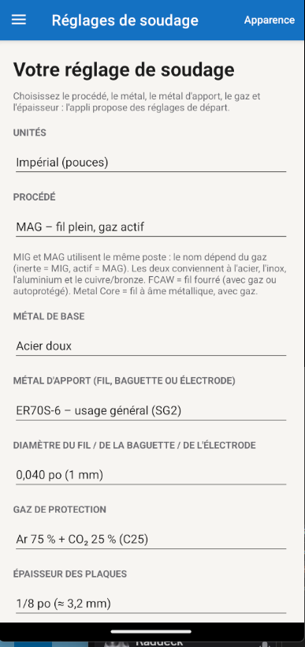
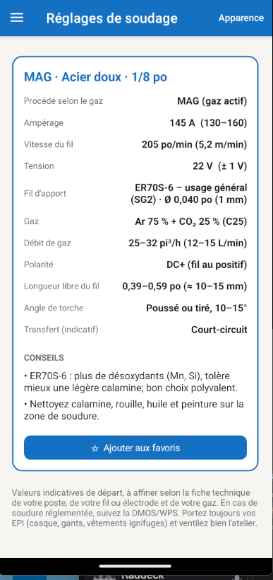
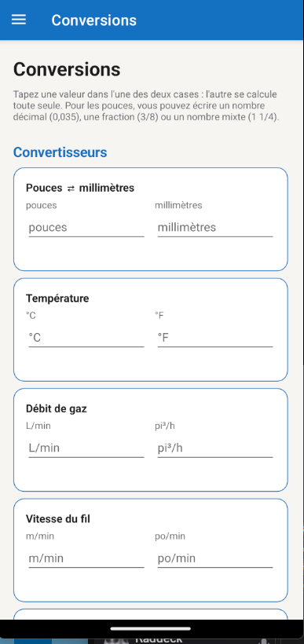
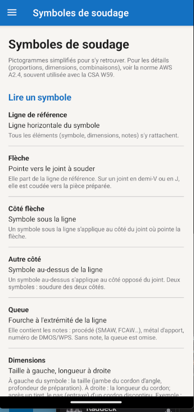
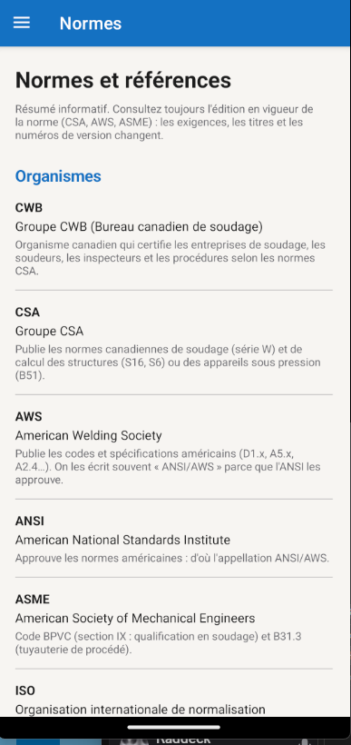
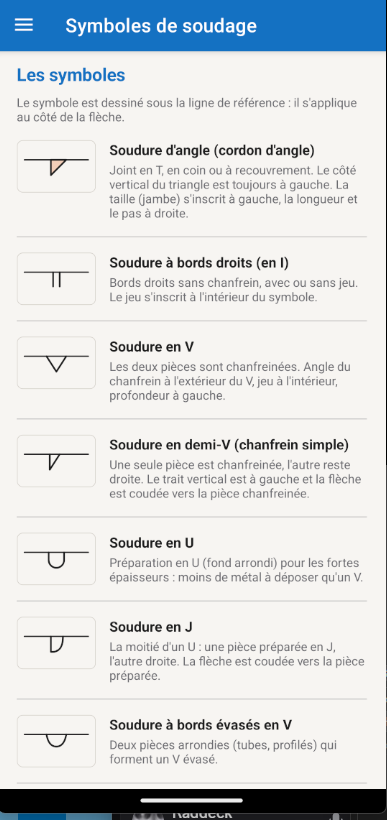

# BetterWelds
Application qui propose des réglages de départ pour souder en MIG, MAG, TIG, SMAW, FCAW et Metal Core, selon le métal de base, le métal d'apport et son diamètre, le gaz de protection, l'épaisseur des plaques et la position de soudage.

     

Application crée avec MAUI et NET8 Android

## Comment installer l'appli:
Vous n'avez qu'à transférer le fichier com.example.weldingsetup.apk sur votre téléphone (par câble USB, Google Drive ou courriel) et à l'ouvrir pour lancer l'installation !

## L'application offre:
1. Propose des réglages pour souder en MIG, MAG, TIG, SMAW, FCAW et Metal Core, selon le métal de base, le métal d'apport et son diamètre, le gaz de protection, l'épaisseur des plaques et la position de soudage.
2. Un menu en haut à gauche pour: les réglages (Accueil), enregistrer vos paramètres en favoris, définitions des normes (CWB / CSA / AWS), des formulaires de conversions, les symboles de soudage et leur définition.
3. Vous pouvez choisir entre unité métrique (mm) ou impérial (po). Les diamètres et les épaisseurs sont affichés dans les deux unités, celle de votre choix en premier.
4. Apparence : offre un choix de 6 thèmes (automatique, clair, sombre, atelier, acier, contraste élevé) et de la couleur d'accent.

## Les options de réglages pour le soudage sont:
1. Type de procédé (MIG, MAG, TIG, SMAW, FCAW ou Metal Core)
2. Métal de base (Aluminium, Acier, Inoxydable)
3. Le métal d'apport et son diamètre
4. Gaz de protection recommandé
5. Épaisseur des plaques

## Application en évolution
- Plus d'options et/ou d'outils y seront ajoutés au fil du temps.

### Important
Les valeurs sont des **réglages de départ** basés sur des ordres de grandeur courants, pas des procédures qualifiées. Elles doivent être validées avec les fiches techniques du poste, du fil ou de l'électrode et du gaz, et avec la DMOS/WPS pour les soudures réglementées. Les pages Normes et Symboles sont des résumés : référez-vous à l'édition en vigueur des normes officielles.
